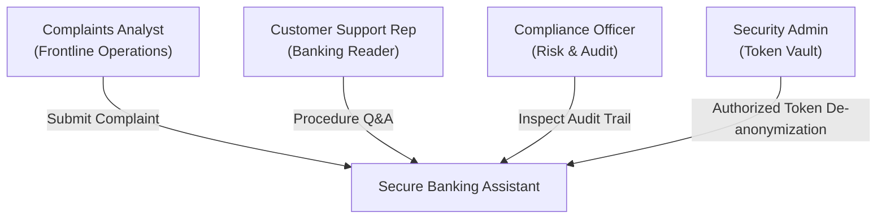

# Business Requirements Document (BRD)

**Project Name:** Secure Banking & Finance Assistant  
**Document ID:** BRD-SEC-BANK-2024-V1  
**Version:** 1.0.0  
**Classification:** Confidential — Financial Services Operations  
**Business Owner:** Retail Banking Operations & Fraud Risk Committee  

---

## 1. Executive Summary & Business Context

Retail financial institutions process tens of thousands of customer complaints, transaction disputes, and operational procedure queries every day. Handling these customer interactions requires significant manual labor from branch representatives, customer support personnel, and back-office dispute analysts.

While modern Generative AI foundation models (such as Amazon Bedrock Anthropic Claude) can dramatically accelerate customer issue summarization and policy guidance, financial regulations strictly prohibit sending customer Personally Identifiable Information (PII), unmasked card numbers, or proprietary financial records to third-party or cloud AI providers without deterministic safeguards.

The **Secure Banking & Finance Assistant** bridges this gap. It provides an automated, secure operational assistant that:
1. Summarizes complex complaints into actionable operational checklists.
2. Delivers instant answers to procedure questions grounded in approved Standard Operating Procedures (SOPs).
3. Enforces deterministic PII redaction **before** AI inference.
4. Guarantees complete auditability through an immutable, append-only PostgreSQL audit trail.

---

## 2. Business Objectives & Key Performance Indicators (KPIs)

| Business Objective | Baseline Metric | Target KPI | Business Value |
| :--- | :--- | :--- | :--- |
| **Dispute Intake Cycle Time** | 18–25 minutes per complaint | < 3 minutes per complaint | 80%+ reduction in operational handling time. |
| **Procedural Inquiry Turnaround** | 10–15 minutes searching manuals | < 15 seconds via API | Rapid onboarding and error reduction for customer service reps. |
| **Zero PII Leakage Incidents** | Ad-hoc manual masking | 100% automated redaction | Elimination of statutory regulatory fines under GLBA & GDPR. |
| **Regulatory Audit Readiness** | 3–5 days to collect case history | Real-time audit trail access | 100% compliance with CFPB and OCC inspection requirements. |

---

## 3. Regulatory Compliance Mandates

The solution is engineered to satisfy the following statutory and regulatory frameworks:

- **Gramm-Leach-Bliley Act (GLBA / 15 U.S.C. § 6801):** Mandates administrative, technical, and physical safeguards to protect nonpublic personal information (NPI).
- **Electronic Fund Transfer Act & Regulation E (12 CFR Part 1005):** Strict timelines for cardholder error resolution (10-day investigation window, 60-day reporting window, provisional credits).
- **NACHA Operating Rules:** Governing ACH dispute returns (Reason Codes R05, R10) and duplicate payment reversals.
- **Payment Card Industry Data Security Standard (PCI-DSS v4.0):** Absolute prohibition against storing or transmitting unmasked Primary Account Numbers (PANs).
- **CFPB Bulletin 2022-06:** Enforcing transparency, fair complaint handling, and absence of deceptive automated financial commitments.

---

## 4. User Personas & Stakeholder Analysis

### Primary User Personas

1. **Complaints Analyst (`Complaints.Analyst`):**
   - *Needs:* Rapid intake of raw complaint narrative, identification of duplicate fees or fraud, extraction of customer's desired outcome, and operational checklist.
   - *Constraints:* Must not view or inadvertently copy customer PII into unauthorized tools.

2. **Customer Service Representative (`Banking.Reader`):**
   - *Needs:* Immediate answers to banking policy questions (e.g., "What is the timeline for card provisional credits under Regulation E?").
   - *Constraints:* Must receive answers strictly grounded in approved bank SOPs without hallucinations.

3. **Compliance & Legal Officer (`Compliance.Officer`):**
   - *Needs:* Comprehensive, immutable records of all automated actions, guardrail interventions, and de-anonymization requests.
   - *Constraints:* Read-only access to audit trail; must provide ticket justification to view original customer PII.

4. **Security Administrator (`TokenVault.Admin`):**
   - *Needs:* Cryptographic key rotation, access policy enforcement, and audit verification for reversible tokens.

---

## 5. Scope: In-Scope vs. Out-of-Scope

### In-Scope (Phase 1 POC)
- Deterministic PII redaction of explicit customer names, phone numbers, emails, IBANs, payment card PANs (Luhn-checked), and customer IDs.
- Integration with Amazon Bedrock Converse API using configured Bedrock Guardrails.
- Reversible token vault with AES-256-GCM envelope encryption backed by AWS KMS.
- Append-only PostgreSQL audit trail capturing sanitised event metadata and latency metrics.
- Microsoft Entra ID (Azure AD) bearer token authentication and RBAC enforcement.
- Local procedure retrieval over approved markdown standard operating procedures.
- Infrastructure as Code (Terraform) provisioning an isolated AWS VPC, private subnets, security groups, and PrivateLink endpoints.

### Out-of-Scope (Deferred to Phase 2 Production)
- Live core banking ledger debit/credit posting (the system explicitly prohibits claiming live execution).
- Public-facing unauthenticated consumer chatbots.
- Multilingual audio / speech-to-text processing.
- Direct external wire dispatch or SWIFT network integration.

---

## 6. Business Workflows & Acceptance Criteria

### Workflow 1: Complaint Summarization
1. **Trigger:** Banking employee receives customer complaint via secure email, phone intake, or portal.
2. **Process:**
   - Employee submits complaint text to `/api/v1/complaints/summarize`.
   - System applies input safety guardrails.
   - System identifies and redacts all PII into stable placeholders (`{{PERSON_1}}`, `{{ACCOUNT_1}}`).
   - If requested, sensitive mappings are encrypted into the token vault.
   - Foundation model summarizes issue, requested resolution, and next steps.
   - Output guardrails verify no sensitive data leaked and no fake financial promises were made.
   - Event is permanently committed to PostgreSQL audit trail.
3. **Acceptance Criteria:** Response is returned within 3 seconds; 0% cleartext PII reaches model prompt or ordinary logs; audit record is committed.

### Workflow 2: Procedural Inquiry Answering
1. **Trigger:** Employee requires clarification on an operational policy (e.g., Regulation E timeline).
2. **Process:**
   - Employee submits natural language query to `/api/v1/chat/ask`.
   - System validates topic relevance and searches approved procedure documents.
   - Reference document snippets are formatted as untrusted boundary context.
   - Bedrock synthesizes a grounded answer referencing specific document IDs.
   - Interaction is audited with referenced document identifiers.
3. **Acceptance Criteria:** Answer is 100% grounded in provided documents; off-topic queries are rejected; no hallucinated transaction claims.
