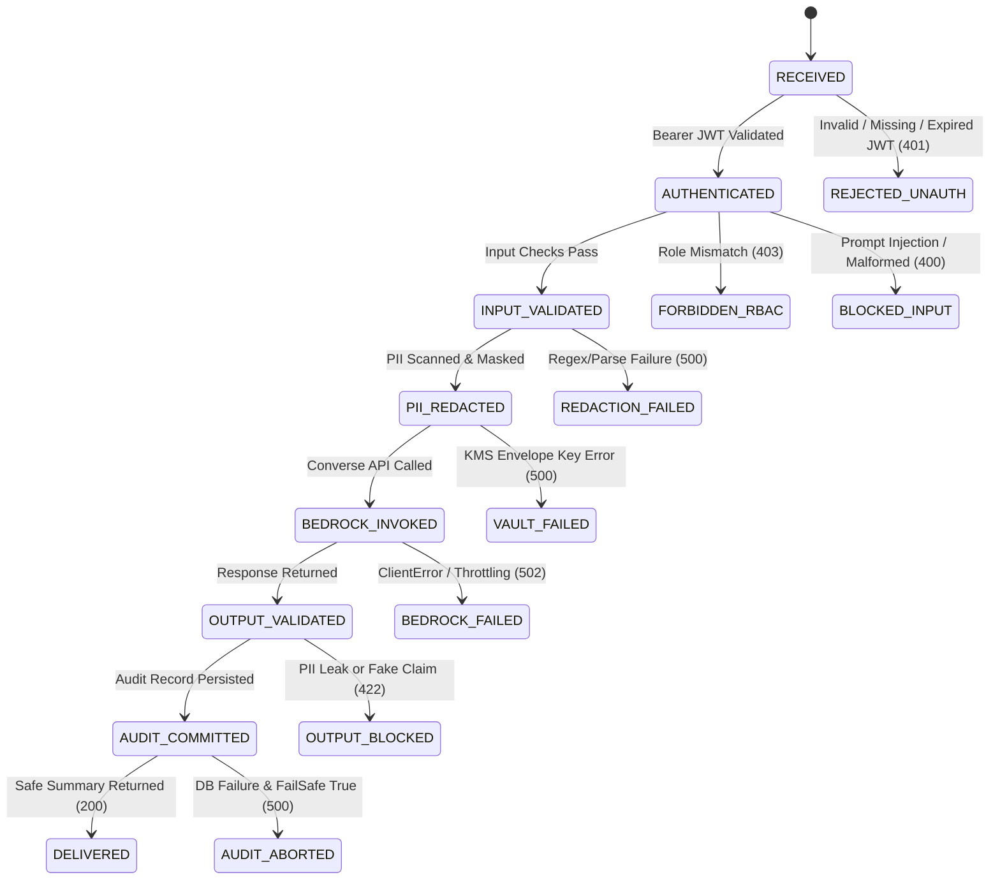
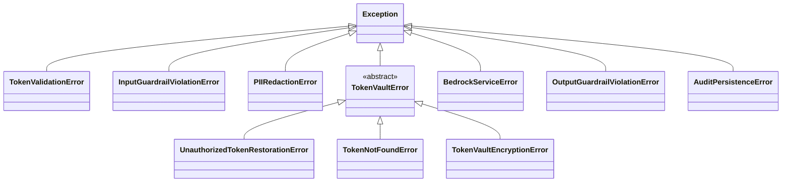

# Functional Design & Engineering Document (FDE)

**Project Name:** Secure Banking & Finance Assistant  
**Document ID:** FDE-SEC-BANK-2024-V1  
**Version:** 1.0.0  
**Classification:** Confidential — Engineering Specifications & Operations  
**Lead Engineer:** Forward Deployed Engineer & Senior AI Security Architect  

---

## 1. Functional System Overview

The **Secure Banking & Finance Assistant** consists of seven core functional subsystems designed to work cohesively to provide privacy-preserving AI assistance for banking operations:

```
[ Incoming Request ]
         │
         ▼
[ 1. Ingestion & Security Middleware ] ──▶ Rejects unauthenticated/invalid requests (HTTP 401/403)
         │
         ▼
[ 2. Input Safety Guardrails ] ─────────▶ Intercepts prompt injections and off-topic requests (HTTP 400)
         │
         ▼
[ 3. Deterministic PII Redaction ] ─────▶ Masks PII into stable placeholders {{PERSON_1}} (Fail-Closed)
         │
         ▼
[ 4. Reversible Token Vault ] ──────────▶ Stores AES-256-GCM envelope-encrypted mappings (Optional)
         │
         ▼
[ 5. Local Procedure Retrieval ] ───────▶ Injects approved SOP context inside <approved_procedure_document>
         │
         ▼
[ 6. Amazon Bedrock Orchestrator ] ─────▶ Invokes Converse API with Bedrock Guardrails
         │
         ▼
[ 7. Output Safety Guardrails ] ────────▶ Intercepts PII leakage and unsupported claims (HTTP 422)
         │
         ▼
[ 8. Append-Only Audit Trail ] ─────────▶ Persists immutable audit event in PostgreSQL (Fail-Safe)
         │
         ▼
[ Sanitized Response Delivered ]
```

---

## 2. Request State Machine & Transition Diagram



---

## 3. Core Algorithms & Logic Specifications

### Algorithm 1: Overlapping PII Span Resolution & End-to-Start Replacement
When multiple regex detectors match overlapping spans in text (e.g., an account number pattern overlapping a credit card pattern), the system resolves conflicts deterministically:

1. **Sort Spans:** Candidate matches `(start, end, entity_type, raw_value)` are sorted by `start` ascending, and then by `length` descending (`-(end - start)`).
2. **Filter Overlaps:** A running pointer `last_end` tracks accepted span boundaries. Any subsequent candidate starting before `last_end` is discarded.
3. **End-to-Start Replacement:** Replacements are executed from the highest string index down to index 0:
   ```python
   replacements.sort(key=lambda x: x[0], reverse=True)
   for start, end, placeholder in replacements:
       text = text[:start] + placeholder + text[end:]
   ```
   *Rationale:* Mutating the string from right-to-left preserves the validity of character offsets for all preceding matches without requiring re-indexing.

### Algorithm 2: Payment Card Luhn Checksum Verification
To eliminate false positives on arbitrary 16-digit account or tracking numbers, card patterns must pass the Luhn mod-10 algorithm:

```python
def luhn_checksum(card_number_digits: str) -> bool:
    digits = [int(c) for c in card_number_digits if c.isdigit()]
    if len(digits) < 13 or len(digits) > 19:
        return False
    # From right to left: last digit is check digit (not doubled)
    checksum = 0
    reverse_digits = digits[::-1]
    for i, d in enumerate(reverse_digits):
        if i % 2 == 1:
            doubled = d * 2
            checksum += doubled - 9 if doubled > 9 else doubled
        else:
            checksum += d
    return checksum % 10 == 0
```

### Algorithm 3: Local Procedure Retrieval & Untrusted Formatting
1. Scans `data/banking_procedures/*.md` on initialization.
2. Extracts query terms, filtering common English stopwords.
3. Computes relevance score:
   $$\text{Score} = (\text{Title Matches} \times 3.0) + (\min(\text{Content Frequency}, 5) \times 0.5)$$
4. Sorts candidates by score descending and selects `top_k = 2`.
5. Encapsulates snippets in `<approved_procedure_document id="...">` XML tags, treating them as passive untrusted data to neutralize secondary injection attacks.

---

## 4. Exception Hierarchy & Error Code Mapping



### HTTP Status Code Resolution Table

| Exception Class | Trigger Condition | HTTP Status | Response Payload |
| :--- | :--- | :---: | :--- |
| `TokenValidationError` | Missing/expired/invalid Bearer token or tenant mismatch. | `401 Unauthorized` | `{"detail": "Bearer token has expired"}` |
| `HTTPException (RBAC)` | Actor lacks required role for requested endpoint. | `403 Forbidden` | `{"detail": "Access forbidden: User lacks required role."}` |
| `InputGuardrailViolationError` | Prompt injection, instruction override, or off-topic query. | `400 Bad Request` | `{"detail": "Input rejected by security guardrails: [reason]"}` |
| `PIIRedactionError` | Unhandled error during regex scanning (Fails Closed). | `500 Internal Error` | `{"detail": "PII Redaction safety check failed. Model invocation aborted."}` |
| `UnauthorizedTokenRestorationError` | Non-admin attempting to de-anonymize token. | `403 Forbidden` | `{"detail": "Actor lacks required role to de-anonymize tokens"}` |
| `TokenNotFoundError` | Token identifier not found in vault or expired. | `404 Not Found` | `{"detail": "Token not found in vault"}` |
| `BedrockServiceError` | AWS Bedrock throttled, access denied, or network failure. | `502 Bad Gateway` | `{"detail": "AI inference provider failed to process complaint safely."}` |
| `OutputGuardrailViolationError` | Model hallucinated transaction execution or leaked PII. | `422 Unprocessable` | `{"detail": "Model output violated banking safety policies: [reason]"}` |
| `AuditPersistenceError` | PostgreSQL commit failed with strict fail-safe enabled. | `500 Internal Error` | `{"detail": "Audit logging service failure. Response withheld under strict compliance policy."}` |

---

## 5. Field Engineering & Production Readiness Checklist

Before promoting the application to production:

- [ ] **Entra ID App Roles:** Verify that App Roles (`Complaints.Analyst`, `Banking.Reader`, `TokenVault.Admin`, `Audit.Viewer`) are mapped to active security groups in Entra ID.
- [ ] **AWS KMS CMK:** Ensure `TOKEN_VAULT_KMS_KEY_ARN` points to an active KMS key with annual rotation enabled.
- [ ] **Bedrock Model Access:** Confirm that `anthropic.claude-3-haiku-20240307-v1:0` access is active in the target AWS region.
- [ ] **Bedrock Guardrail ARN:** Publish Guardrail Version `1` and set `BEDROCK_GUARDRAIL_ID` in production environment configuration.
- [ ] **PostgreSQL Privilege Separation:** Execute the privilege hardening script from `docs/security-controls.md` to enforce `INSERT`-only on `audit_events` for `app_audit_writer`.
- [ ] **Fail-Safe Verification:** Confirm `AUDIT_STRICT_FAIL_SAFE=true` in production environment variables.
- [ ] **Container Security:** Ensure the container image runs as non-root `appuser` (UID 10001).
- [ ] **Automated Tests:** Execute `python -m pytest -v` to confirm 35/35 tests pass cleanly in the deployment pipeline.
