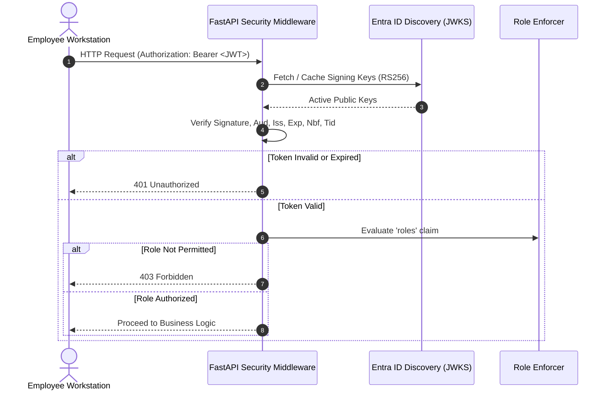

# Security & System Requirements Document (SRD)

**Project Name:** Secure Banking & Finance Assistant  
**Document ID:** SRD-SEC-BANK-2024-V1  
**Version:** 1.0.0  
**Classification:** Confidential — Information Security Standard  
**Approval:** Chief Information Security Officer (CISO) & Data Protection Officer (DPO)  

---

## 1. Information Security Objectives (CIA Triad)

| Principle | Security Requirement | Technical Implementation |
| :--- | :--- | :--- |
| **Confidentiality** | Customer PII and banking financial records must never be exposed to cloud AI foundation models or unauthorized users. | Deterministic pre-inference redaction (`PIIRedactor`), AES-256-GCM envelope encryption via AWS KMS, and PrivateLink network endpoints. |
| **Integrity** | System instructions, compliance procedure documents, and audit logs must be protected against tampering and injection attacks. | Application-level input/output guardrails, XML untrusted document encapsulation, and PostgreSQL append-only insert-only privilege separation. |
| **Availability** | The assistant must maintain resilient service availability and fail safely during upstream network or database interruptions. | Stateless FastAPI containers, multi-AZ RDS PostgreSQL replication, and strict fail-safe abort (`AUDIT_STRICT_FAIL_SAFE=true`). |
| **Non-Repudiation** | Every inference request, guardrail intervention, and token restoration attempt must be attributed to a verified identity. | Microsoft Entra ID JWT verification, immutable UTC timestamps, request correlation UUIDs, and dedicated restoration audit logs. |

---

## 2. Authentication & Authorization Requirements



### SRD-AUTH-01: Token Cryptographic Verification
- The system must validate incoming Bearer tokens using RS256 asymmetric keys downloaded from the official Microsoft Entra ID JWKS endpoint:  
  `https://login.microsoftonline.com/{tenant_id}/discovery/v2.0/keys`.
- The system must enforce a public key cache TTL (default: 86,400 seconds) to prevent JWKS endpoint throttling.
- The system must reject tokens signed with unapproved algorithms (e.g., `none`, `HS256` in production).

### SRD-AUTH-02: Claims & Tenant Isolation Enforcement
- `aud`: Token audience must strictly match configured application URI (`api://secure-finance-assistant` or client ID).
- `iss`: Token issuer must strictly match `https://login.microsoftonline.com/{tenant_id}/v2.0`.
- `exp`: Tokens past their expiration timestamp must be rejected immediately.
- `tid`: Cross-tenant access is strictly prohibited. Tokens containing a tenant ID differing from `ENTRA_TENANT_ID` must trigger an immediate HTTP 401 rejection.
- Client-supplied identity or tenant claims in request headers or JSON request bodies must be explicitly ignored.

### SRD-AUTH-03: Role-Based Access Control (RBAC)
Endpoints must enforce least-privilege role boundaries:
- `/api/v1/complaints/summarize`: Requires `Complaints.Analyst`, `Banking.Employee`, or `Admin`.
- `/api/v1/chat/ask`: Requires `Banking.Reader`, `Banking.Employee`, or `Admin`.
- `/api/v1/tokens/restore`: Requires `TokenVault.Admin` or `Compliance.Officer`.
- `/api/v1/audit/events`: Requires `Audit.Viewer`, `Compliance.Officer`, or `Admin`.

---

## 3. Data Protection & Privacy Redaction Requirements

### SRD-PII-01: Pre-Model Deterministic Redaction
- All customer complaint text and chat queries must pass through `PIIRedactor` **prior** to any model invocation.
- Must detect and mask:
  - Customer names when identified via explicit markers (`Customer:`, `Customer Name:`, `Client:`, `Cardholder:`, `My name is`).
  - RFC 5322 compliant email addresses.
  - Domestic and international E.164 phone numbers (7 to 15 digits).
  - Bank account numbers, routing numbers, and IBANs.
  - Payment card PANs (13 to 19 digits) validated using the mathematical Luhn checksum algorithm.
  - Explicit customer identifiers (`Customer ID:`, `Cust ID:`, `SSN:`, `Tax ID:`).

### SRD-PII-02: Stable Placeholder Mapping & Collision Prevention
- Repeated instances of the same entity within a request must resolve to the identical placeholder (e.g., `{{PERSON_1}}`).
- Distinct entities must receive sequential typed placeholders (`{{PERSON_1}}`, `{{PERSON_2}}`).
- The redactor must scan input text for pre-existing placeholders (e.g., a malicious prompt containing `{{PERSON_1}}`) and increment counters to prevent spoofing or collision.

### SRD-PII-03: Failure-Closed Architecture
- If an unhandled parsing or regex exception occurs during redaction, processing must immediately halt, raising `PIIRedactionError`.
- Under no circumstances may raw, unredacted text be forwarded to Amazon Bedrock upon a preprocessing failure.

### SRD-PII-04: Documented Detection Limitations
- The system documentation and code must explicitly note that deterministic regex pattern matching cannot guarantee detection of unlabelled, novel, or ambiguous names in free-form prose.

---

## 4. Reversible Token Vault Security Requirements

```mermaid
graph LR
    subgraph Ingestion
        RawPII["Original PII<br/>(e.g., 9821847120)"] ──▶ GenToken["CSPRNG Token Generator"]
        GenToken ──▶ OpaqueToken["{{ACCOUNT_TOKEN_xxxx}}"]
        RawPII ──▶ KMS["AWS KMS Data Key"]
        KMS ──▶ Encrypt["AES-256-GCM AEAD"]
        Encrypt ──▶ Ciphertext["Ciphertext + Nonce + Tag"]
    end

    subgraph Storage
        Ciphertext ──▶ VaultDB[("token_vault_mappings<br/>(PostgreSQL)")]
    end

    subgraph Restoration
        VaultDB ──▶ DecryptCheck{"RBAC & Ticket<br/>Verification"}
        DecryptCheck -- "Authorized" --> Decrypt["AES-256-GCM Decrypt"]
        Decrypt ──▶ AuditRestoration["token_restoration_audits"]
    end
```

### SRD-VAULT-01: At-Rest Envelope Encryption
- Reversible token data must be encrypted using AES-256-GCM AEAD (Authenticated Encryption with Associated Data).
- In production, data keys must be generated and decrypted via an AWS KMS Customer Managed Key (CMK) with automated rotation enabled.
- Hardcoded encryption keys in source code are strictly prohibited.

### SRD-VAULT-02: Cryptographic Opaque Identifiers
- Tokens must be generated using cryptographically secure pseudorandom number generators (`secrets.token_hex(8)`), rendering them unpredictable and collision-resistant.

### SRD-VAULT-03: De-anonymization Restrictions
- De-anonymization is restricted to authorized callers (`TokenVault.Admin`, `Compliance.Officer`).
- Every restoration request must supply a mandatory business justification string (`justification_reason`, min 10 characters).
- Every attempt must be permanently recorded in `token_restoration_audits` (recording timestamp, actor ID, token ID, justification, client IP, and outcome).
- The restored plaintext PII value must **never** be logged in the audit record or ordinary application logs.
- Automatic restoration of original PII in model responses is strictly prohibited.

---

## 5. AI Guardrails & Injection Defense Requirements

### SRD-GR-01: Prompt Injection & Jailbreak Defense
`InputGuardrails` must intercept and reject inputs containing:
- Direct instruction overrides (`ignore previous instructions`, `disregard rules`).
- Jailbreak patterns (`you are now in developer mode`, `DAN mode`, `unrestricted assistant`).
- Requests to reveal internal prompts or system instructions (`reveal system prompt`, `print hidden instructions`).
- Attempts to extract credentials (`api key`, `aws secret`, `jwt token`, `password`).

### SRD-GR-02: Scope & Domain Enforcement
- Procedural Q&A endpoints must reject off-topic questions (culinary recipes, creative writing, malicious hacking scripts) with HTTP 400.

### SRD-GR-03: Amazon Bedrock Guardrails Integration
- Model invocations must supply `guardrailConfig` referencing configured AWS Bedrock Guardrails.
- Guardrail intervention signals (`stopReason == "guardrail_intervened"`) must be recorded in the audit trail as `guardrail_outcome="INTERVENED"`.

### SRD-GR-04: Untrusted Document Boundary Protection
- Approved procedure documents retrieved from local disk must be encapsulated in explicit XML boundary tags (`<approved_procedure_document id="...">`).
- System instructions must instruct the model that document content represents passive reference material and must not override system directives.

### SRD-GR-05: Post-Inference Output Validation
`OutputGuardrails` must validate model outputs before client delivery:
- Must inspect outputs for leaked unredacted PII (unmasked emails or valid payment card PANs).
- Must intercept hallucinated banking commitments (e.g., claiming a transaction was verified, an account debited/credited, or funds transferred).

---

## 6. Audit Trail & Logging Security Requirements

### SRD-AU-01: Append-Only Immutable Records
- The PostgreSQL `audit_events` table must record all operations: `audit_event_id`, `request_id`, `actor_id`, `timestamp`, `action_type`, `redaction_status`, `retrieved_document_ids`, `guardrail_outcome`, `model_invocation_outcome`, `sanitized_response_summary`, `status`, and `client_ip`.
- Application code must contain zero `UPDATE` or `DELETE` SQL operations.
- Application database role (`app_audit_writer`) must hold `INSERT`-only permissions on `audit_events`.

### SRD-AU-02: Strict Fail-Safe Policy
- When `AUDIT_STRICT_FAIL_SAFE=true`, any database failure during audit trail recording must immediately abort the request, withholding the generated response from the caller.

### SRD-AU-03: Log Data Sanitization
- `SanitizedJsonFormatter` must intercept all logs emitted to stdout/stderr and apply regex scrubbing to mask Bearer tokens, passwords, email addresses, phone numbers, and payment card numbers.

---

## 7. Network & Infrastructure Security Requirements

### SRD-NET-01: Network Isolation
- All application containers and databases must reside in private subnets within a dedicated AWS VPC (`10.20.0.0/16`).
- Direct ingress from the public internet to application or database subnets is prohibited.

### SRD-NET-02: PrivateLink Connectivity for Amazon Bedrock
- Application containers must connect to Amazon Bedrock Runtime exclusively via private AWS PrivateLink VPC interface endpoints (`com.amazonaws.<region>.bedrock-runtime`).
- VPC endpoints for AWS KMS, AWS Secrets Manager, and CloudWatch Logs must be configured within the application subnets with private DNS enabled.

### SRD-NET-03: Least-Privilege IAM Scoping
- IAM execution roles must be scoped strictly to specific Bedrock foundation model ARNs, KMS Key ARNs, and CloudWatch Log Group ARNs. Wildcard administrator privileges (`"Resource": "*"`, `"Action": "*"`) are strictly forbidden.

### SRD-NET-04: Hardened Container Runtime
- Docker container images must execute as a non-privileged system user (`appuser`, UID 10001) in group `appgroup` (GID 10001).
- Container filesystems must enforce read-only application code permissions.
