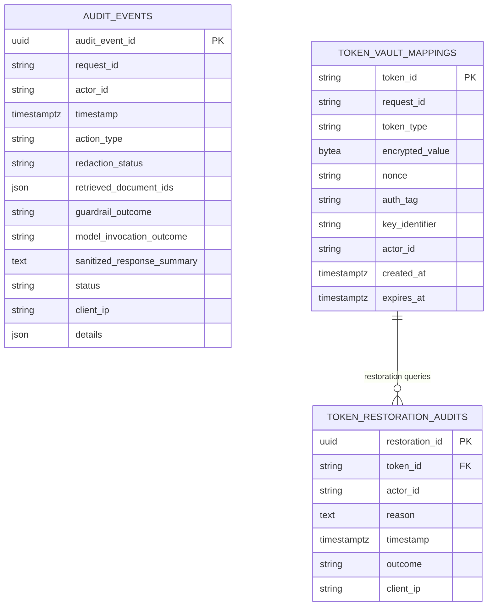

# Technical Requirements Document (TRD)

**Project Name:** Secure Banking & Finance Assistant  
**Document ID:** TRD-SEC-BANK-2024-V1  
**Version:** 1.0.0  
**Classification:** Confidential — Engineering Architecture Specification  
**Lead Architect:** Senior Python Backend & AI Infrastructure Engineer  

---

## 1. Technology Stack Specifications

| Layer / Component | Technology | Version | Justification & Architecture Notes |
| :--- | :--- | :--- | :--- |
| **Language Runtime** | Python | `>= 3.11, < 3.14` | High-performance async runtime, native typing, and cryptographic module support. |
| **Web Framework** | FastAPI | `0.115.6` | High-throughput asynchronous ASGI web framework with native Pydantic schema validation. |
| **ASGI Server** | Uvicorn | `0.34.0` | Minimal, high-performance event loop server with uvloop and httptools. |
| **Validation Engine** | Pydantic / Pydantic Settings | `2.10.4` / `2.7.0` | Strict type enforcement, environment variable parsing, and sanitization. |
| **Relational Database** | PostgreSQL | `15.5` | ACID-compliant relational storage for append-only audit logs and token mappings. |
| **ORM & DBAPI** | SQLAlchemy / asyncpg | `2.0.36` / `0.30.0` | 2.0-style async declarative ORM; asyncpg driver for high-performance non-blocking queries. |
| **AI Foundation Model** | Amazon Bedrock Runtime | API v1 | `converse` API leveraging Anthropic Claude 3 Haiku or Titan Text Express with Guardrails. |
| **Identity Provider** | Microsoft Entra ID | OAuth 2.0 / OIDC | Enterprise RS256 JWT validation against OpenID Connect discovery JWKS. |
| **Cryptography** | cryptography / PyJWT | `44.0.0` / `2.10.1` | Native AES-256-GCM AEAD ciphers and RS256 JWT signature verification. |
| **Infrastructure as Code** | HashiCorp Terraform | `>= 1.5.0` | Reproducible AWS VPC, RDS, KMS, IAM, and PrivateLink infrastructure provisioning. |
| **Containerization** | Docker / Compose | Multi-stage | Minimal `python:3.11-slim` runner with non-root UID 10001 system user. |

---

## 2. Database Schema & Data Models



### Table 1: `audit_events`
- **Primary Key:** `audit_event_id` (`UUID`, generated via `uuid.uuid4`).
- **Indexes:** `idx_audit_request_id` (`request_id`), `idx_audit_actor_id` (`actor_id`), `idx_audit_timestamp` (`timestamp DESC`).
- **Constraint:** Application role `app_audit_writer` holds `INSERT`-only grant.

### Table 2: `token_vault_mappings`
- **Primary Key:** `token_id` (`VARCHAR(128)`, e.g., `{{ACCOUNT_TOKEN_1a2b3c4d}}`).
- **Indexes:** `idx_token_request_id` (`request_id`), `idx_token_expires_at` (`expires_at ASC`).
- **Security:** `encrypted_value` contains AES-256-GCM ciphertext bytes; `nonce` (96-bit base64 IV); `auth_tag` (128-bit base64 tag).

### Table 3: `token_restoration_audits`
- **Primary Key:** `restoration_id` (`UUID`).
- **Foreign Reference:** `token_id` (`VARCHAR(128)`).
- **Invariants:** Plaintext PII is **never** written to `reason` or any column in this table.

---

## 3. Configuration Management (`Settings`)

Configuration is validated via Pydantic `BaseSettings` (`app/core/config.py`):

```python
class Settings(BaseSettings):
    # Application Core
    APP_NAME: str = "secure-finance-assistant"
    APP_ENV: str = "production"  # development, test, production
    DEBUG: bool = False
    LOG_LEVEL: str = "INFO"
    API_V1_STR: str = "/api/v1"

    # Microsoft Entra ID (Azure AD)
    ENTRA_TENANT_ID: str
    ENTRA_CLIENT_ID: str
    ENTRA_AUDIENCE: str = "api://secure-finance-assistant"
    ENTRA_ISSUER: Optional[str] = None
    ENTRA_JWKS_CACHE_TTL_SECONDS: int = 86400
    AUTH_MOCK_ENABLED: bool = False

    # PostgreSQL Database
    DATABASE_URL: Optional[str] = None
    DATABASE_POOL_SIZE: int = 10
    DATABASE_MAX_OVERFLOW: int = 20
    DATABASE_TIMEOUT_SECONDS: int = 10
    AUDIT_STRICT_FAIL_SAFE: bool = True

    # Amazon Bedrock & Guardrails
    AWS_REGION: str = "us-east-1"
    BEDROCK_MODEL_ID: str = "anthropic.claude-3-haiku-20240307-v1:0"
    BEDROCK_GUARDRAIL_ID: Optional[str] = None
    BEDROCK_GUARDRAIL_VERSION: str = "1"
    BEDROCK_INVOCATION_TIMEOUT_SECONDS: int = 30
    BEDROCK_ENDPOINT_URL: Optional[str] = None
    BEDROCK_MOCK_ENABLED: bool = False

    # Token Vault & Cryptography
    TOKEN_VAULT_KEY_PROVIDER: str = "kms"  # kms, local_envelope
    TOKEN_VAULT_KMS_KEY_ARN: Optional[str] = None
    TOKEN_VAULT_LOCAL_KEY: Optional[str] = None
    TOKEN_VAULT_DEFAULT_EXPIRY_DAYS: int = 90
```

---

## 4. Amazon Bedrock API Invocation Contract

The system uses the Amazon Bedrock `converse` runtime endpoint:

```json
{
  "modelId": "anthropic.claude-3-haiku-20240307-v1:0",
  "messages": [
    {
      "role": "user",
      "content": [
        {
          "text": "Please summarize this customer complaint:\n\nCustomer {{PERSON_1}} on Account {{ACCOUNT_1}}..."
        }
      ]
    }
  ],
  "system": [
    {
      "text": "You are a Banking Customer Operations Assistant. Analyze the following sanitized customer complaint where sensitive PII has been redacted using {{PLACEHOLDER}} tokens. You MUST NOT claim that any transaction has been verified, refunded, or executed..."
    }
  ],
  "inferenceConfig": {
    "maxTokens": 600,
    "temperature": 0.0
  },
  "guardrailConfig": {
    "guardrailIdentifier": "gr-1234567890ab",
    "guardrailVersion": "1",
    "trace": "enabled"
  }
}
```

---

## 5. Non-Functional & Performance SLAs

| Metric | Target SLA | Implementation Detail |
| :--- | :--- | :--- |
| **Complaint Summarization Latency** | `p95 < 3.0s` | Streamlined regex redaction (< 10ms) + Bedrock Converse API latency (~1.5–2.5s). |
| **Procedure Q&A Latency** | `p95 < 2.0s` | In-memory token-overlap document search (< 5ms) + Bedrock synthesis (~1.2s). |
| **Token Restoration Latency** | `p95 < 80ms` | Single indexed key lookup in PostgreSQL + AES-256-GCM decrypt (< 15ms). |
| **Database Connection Pool** | Max 30 connections | 10 persistent pool connections + 20 overflow; pre-ping enabled to discard dead sockets. |
| **Throughput Capacity** | 100 req/sec | Scalable horizontally via stateless container replicas behind an AWS Network/Application Load Balancer. |
| **Input Buffer Defense** | Max 4,000 characters | Enforced at FastAPI Pydantic schema validation layer before memory allocation. |
