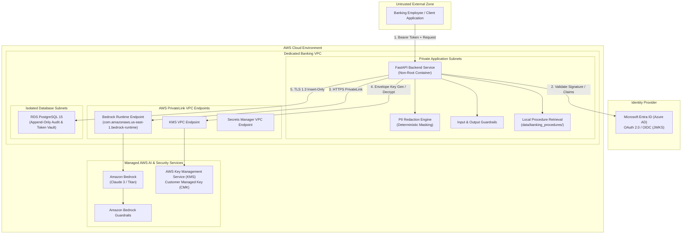
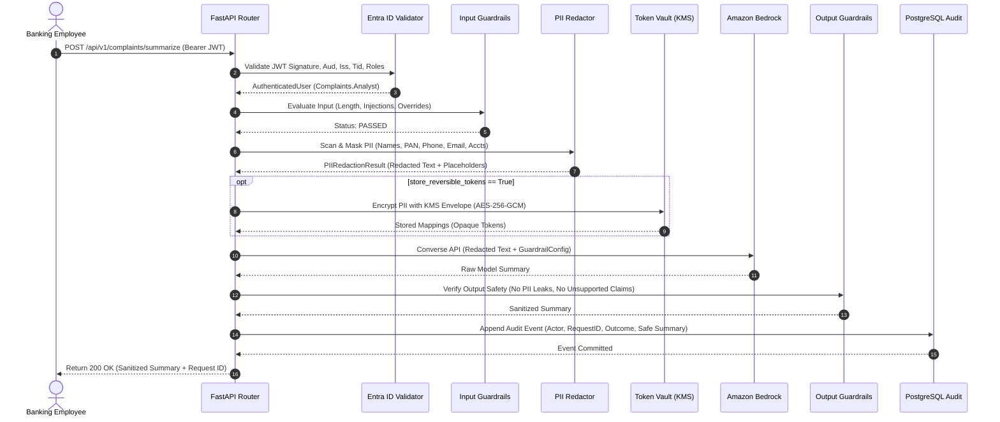
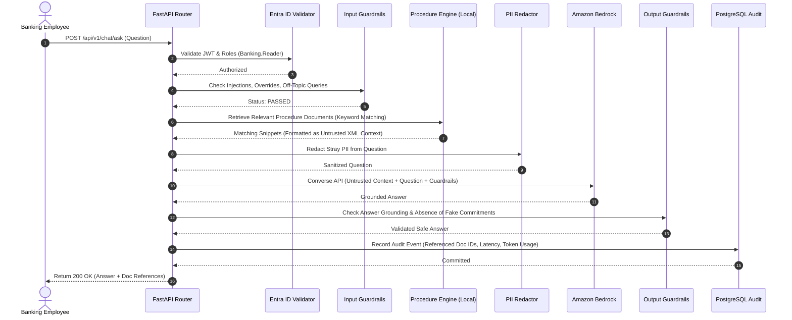
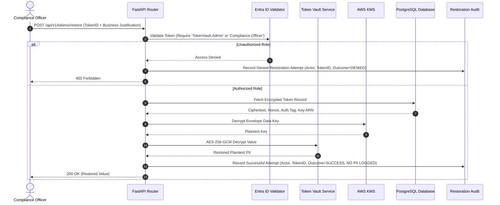

# System Architecture: Secure Banking & Finance Assistant POC

## 1. System Overview and Goals

The **Secure Banking & Finance Assistant** provides an automated operational interface for retail banking employees. It enables:
1. **Complaints Summarization:** Extracting customer issues, requested remediations, and operational next steps without exposing customer PII to cloud foundation models.
2. **Procedural Q&A:** Answering employee policy questions grounded strictly in approved bank procedure documents.
3. **Reversible Token Vault:** Isolating and encrypting sensitive customer data under strict RBAC and audit controls.
4. **Append-Only Auditing:** Maintaining an immutable record of all inference interactions, redactions, guardrail interventions, and de-anonymization requests.

---

## 2. High-Level Architecture & Trust Boundaries

---

## 3. Core Component Workflows

### A. Complaint Summarization Flow

---

### B. Procedural Q&A Flow

---

### C. Reversible Token Vault & De-anonymization Flow

---

## 4. Network and Private Infrastructure Topology

1. **VPC Architecture:**
   - Dedicated CIDR `10.20.0.0/16` spanned across multi-AZ configurations.
   - **Tier 1 (Application):** Private subnets without Internet Gateways. Only accessible via internal load balancer.
   - **Tier 2 (Database):** Isolated database subnets without external routing of any kind.
2. **Bedrock Private Connectivity:**
   - Instead of routing across public internet, traffic flows through `com.amazonaws.us-east-1.bedrock-runtime` AWS PrivateLink VPC interface endpoints located inside the application subnets.
3. **Storage Security:**
   - PostgreSQL runs on RDS with AES-256 KMS storage encryption, forced SSL/TLS connections (`rds.force_ssl = 1`), and automated snapshots.
